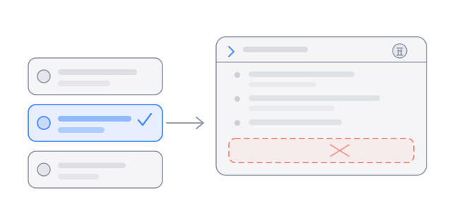

- Roll back to the start of a turn: `/ctxmgr turns` to read the turn numbers, `/ctxmgr deleteturn 5` to remove that whole turn from the context, then ask again.
- Drop noise: `/ctxmgr list` to find the indexes, `/ctxmgr delete 12,13,14` to clear error logs and trial-and-error instructions entry by entry.
- Forget superseded conclusions: delete the turns that hold plans which were later overturned, so the model stops citing them.
- Honest limit: this only removes content from the model context; the raw session log and chat transcript stay in the local session file, and this plugin is not an eraser.
