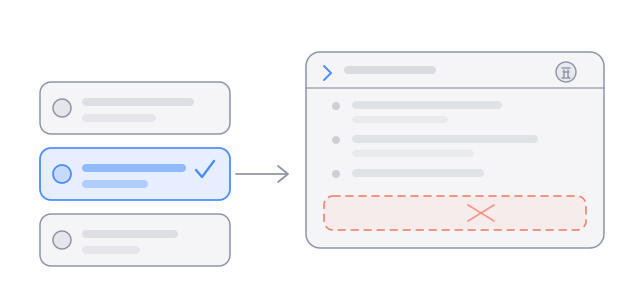

- 回退到某一轮的开始：`/ctxmgr turns` 查看轮号，`/ctxmgr deleteturn 5` 把该轮整体移出上下文，然后重新提问。
- 清除废物信息：`/ctxmgr list` 找到序号，`/ctxmgr delete 12,13,14` 按条清掉报错日志与试错指令。
- 让模型忘掉过时的中间结论：删掉被推翻的方案所在的轮次，避免它反复引用旧结论。
- 止损边界：只移出模型上下文，原始会话日志与聊天记录仍留在本地会话文件里，本插件不是擦除工具。

- token 估算：列表里的 `≈N tok` 与总占用来自 `core.js` 的 `estimateMessageTokens`，定价与 DSH 官方 `dsh-token-meter` 同源——4 字符 ≈ 1 token、每个内容块 +4、每条消息角色开销 +4。Host 有 token-meter 时优先用 `ctx.tokenMeter.measure()` 的节点定价，否则回退本地启发式。
- 这只是估算：中文与 JSON 明显被低估，实际省下的 token 通常多于显示值。
- 按预算清理：`/ctxmgr clean 60000`（工具等价 `context_manager` + `clean`）把 `tool` / `assistant` 候选按估算 token 降序删除，达到预算即停止。用户消息与上下文消息永不入选，默认保护最近 3 条，候选默认 ≥100 tokens；删除复用同一套墓碑与持久队列，仍可恢复。

- 批次审计：每次删除、整轮删除与按预算清理都会生成 `batchId`，写进墓碑消息的 `source`：`{ kind: 'context-manager', batchId: '<uuid>' }`。
- `kind` 仍是唯一标记，因此旧墓碑没有 `batchId` 也照常识别与恢复。
- 台账：每次操作在会话日志追加一条 `plugin:context-manager/batch` 记录——`batchId`、`op`（`delete` / `delete-turn` / `clean` / `undo`）、`seqs`、`tombstoneSeqs`、`estimatedFreedTokens`、结果（`applied` / `queued` / `skipped` / `failed`）与 `reason`。
- 台账只增不改，随会话日志持久化，重启后仍可查，不写外部文件。
- 撤销：`/ctxmgr batches` 查看台账；`/ctxmgr undo-batch [batchId]` 撤销最近一次或按 batchId 前几位撤销指定批次（工具 `action=batches` / `action=undo-batch`）。
- 撤销复用既有 restore 路径（持久队列 + ack 幂等），不是新的恢复机制，并会留下自己的 `op=undo` 台账记录。
